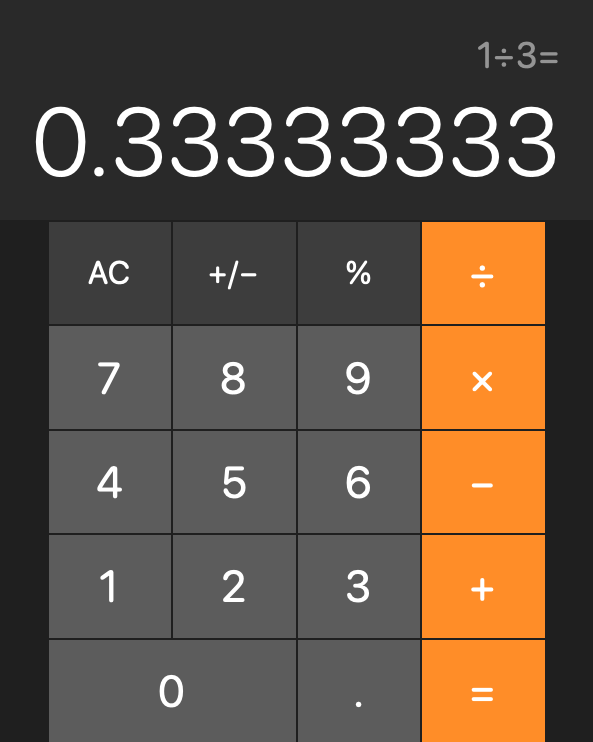
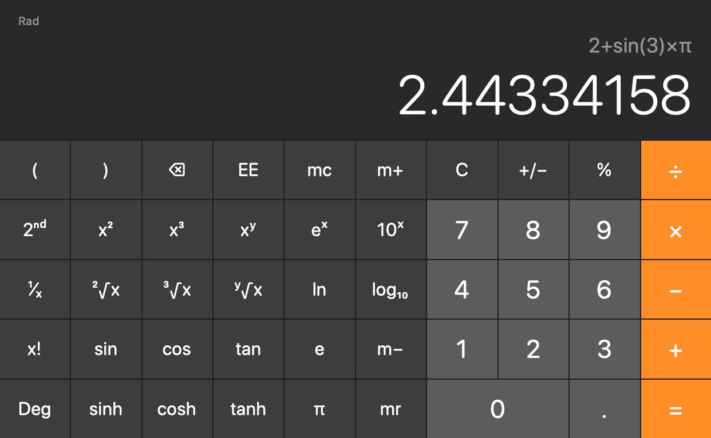
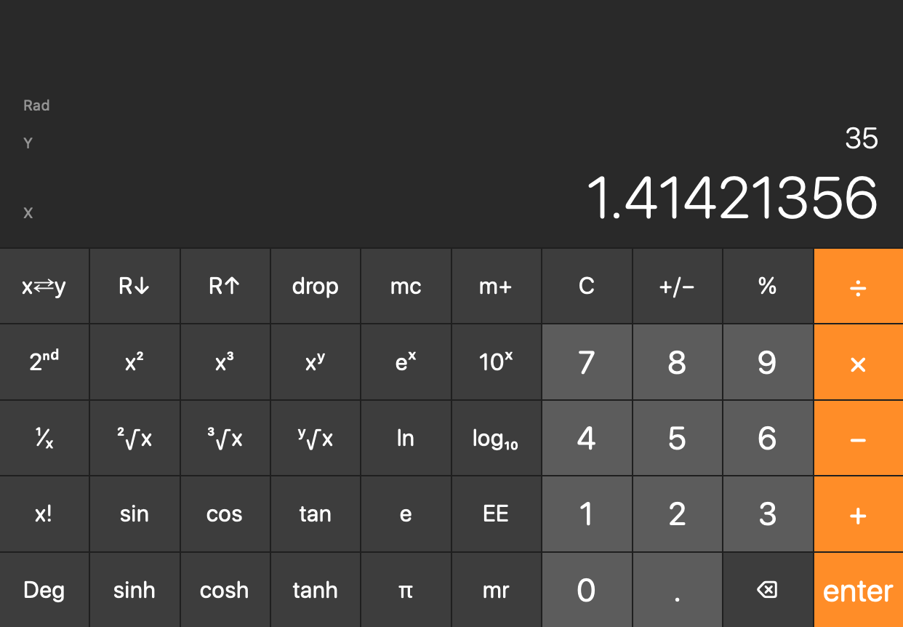

# DecCalc

A macOS calculator (Basic, Scientific and RPN) that reproduces the behavior of the
macOS Calculator's engine, the private `Calculate.framework`, without using it.
The engine was reverse engineered and is reimplemented here in Swift on top of
Intel's open-source decimal floating-point library — the same arithmetic library
Apple links into `Calculate.framework`.

| Basic | Scientific | RPN |
| --- | --- | --- |
|  |  |  |

## Build and run

Requires macOS 14 or later and the Xcode command-line tools.

```sh
swift run DecCalc          # the app
swift test                 # unit tests
Tools/make-app.sh          # builds .build/DecCalc.app
```

`calc` is a command-line front end used for testing:

```sh
echo "K 0 0 digit3 add digit4 sine" | swift run calc
# K  digit3 add digit4 sine  plain=3+sin(4)  value=2.243197504692071748627360905488171  shown=2.2431975
```

## Architecture

| Target | Contents |
| --- | --- |
| `CBID`, `CBIDF128` | Intel Decimal Floating-Point Math Library 2.0 U5, unmodified (BSD-3). See `Vendor/README.md`. |
| `CalcCore` | `Decimal128` (decimal128 values and status flags), `Evaluator` (parser and evaluation), `InfixEditor` (key presses → expression text), `RPNStack`, `DisplayFormatter`, `Calculator` (facade). |
| `DecCalcApp` | SwiftUI app: layouts, memory, 2nd functions, keyboard input, ⌘C. `--snapshot <dir>` renders the screenshots. |
| `calc` | Line-protocol CLI for differential testing. |

Like the original, the infix calculator works on text: keys edit an expression
("3+sin(4)"), and the expression is parsed and evaluated with 34-digit decimal
arithmetic. In RPN mode each operation evaluates immediately and stores its result
as a full-precision literal ("3333333333333333333333333333333333E-34").

## Differential testing

`Tools/Oracle` links the system's `Calculate.framework` through interface stubs (it
never ships with the app) and answers the same line protocol as `calc`.
`Tools/DiffTest/difftest.py` replays random key sequences on both and compares the
expression text, the exact value, the displayed value and the RPN stack.

```sh
Tools/Oracle/build.sh
swift build -c release --product calc
python3 Tools/DiffTest/difftest.py --mode infix --profile typical --cases 5000
python3 Tools/DiffTest/difftest.py --mode rpn --same-plain        # evaluation and display only
Tools/DiffTest/compare.sh "2 power 10" "deg 30 sine"            # side by side
```

Results (5000 cases each, macOS 26, seed 101):

| Mode | Everyday keys, 2–12 keys | Everyday keys, 2–5 keys | Any keys, 2–12 keys | Any keys, 2–5 keys |
| --- | --- | --- | --- | --- |
| Infix | 96.7% | 98.8% | 85.0% | 95.0% |
| RPN | 96.5% | 98.4% | 88.2% | 94.1% |

When the expression text matches, the exact value and the display match in 98.6% of
infix cases. "Everyday keys" are mostly digits and + − × ÷ with some functions;
"any keys" draws from every key except Rand (weighted by key group), so it
exercises rare combinations.

### Known differences

- **Powers** (`xʸ`, `x²`, `eˣ`, `yˣ`, `ʸ√x`): Apple uses its own modified power
  routine (`bid128_pow_fix`). About 12% of non-integer-base powers differ from it in
  the last of 34 digits (at most 8 units in the last place). Displayed values agree.
- **Parameter slots**: in Apple's editor the index of `ʸ√x` and the base of `logᵧ`
  and `yˣ` accept whole sub-expressions ("root(4, log(7))", "log(π, 8)"). DecCalc
  accepts numbers and constants there.
- Some rare key orders in the editor, such as a function key inside a fresh `yˣ`
  slot or `1/x` on an empty slot, produce different text.
- App-level behavior (what "=" followed by a digit does, history) is modeled on the
  Calculator app but was not compared automatically.

## Behavior reference

Rules recovered from `Calculate.framework` and confirmed against it:

- Arithmetic: decimal128, rounding half away from zero. Constants π =
  3.141592653589793238462643383279503 and 𝑒 = 2.718281828459045235360287471352662.
- Results must lie in binary64's normal range (about 2.2251×10⁻³⁰⁸ to
  1.7977×10³⁰⁸); intermediate values may exceed it. Any non-finite intermediate
  value (log 0, a pole of tan) is an error.
- `x!` is Γ(x+1), rounded to a whole number for whole x (so 30! ends in …998);
  defined up to x = 103.
- Degrees: x × (π÷180) with the factor computed once, half away from zero; inverse
  functions multiply by 180÷π. Trigonometric results within ±10⁻³¹ are 0; tan beyond
  10³¹ is an error.
- `logᵧ x` and `log₂ x` are log₁₀ x ÷ log₁₀ y.
- Precedence: unary minus is below `^` ("-2^2" = −4), `^` is right-associative,
  juxtaposition multiplies ("2π^2" = 2×π²).
- `%`: "5%" is 0.05; "50+10%" is 55; "50×10%" is 5. Between operands it is floored
  modulo ("17%945" = 17, "-794%4" = 2) unless its left factor follows × or ÷, where
  it means percent-of ("3×17%945" = 481.95). A trailing "%" applies to a whole power
  ("8^26%").
- Display (Calculator.app defaults): NumberFormatter with 8 fraction digits plus the
  number of zeros that lead the fraction ("1.098612289", "0.00014285714"), grouping;
  scientific notation above 10 integer digits or at or below 10⁻⁹.
- RPN: Enter duplicates X and the next digit replaces the copy; `xʸ` is X^Y, `yˣ`
  is Y^X, `ʸ√x` is the Y-th root of X, `logᵧ` is log base Y of X, `%` is Y×X÷100
  with Y kept; errors leave a blank 0.

## License

DecCalc's own code is provided as is. The Intel library is under Intel's BSD-3-Clause
license (`Sources/CBID/LICENSE-Intel.txt`). No Apple code or binary is included;
`Tools/Oracle` links the system framework on the developer's machine for testing only.
